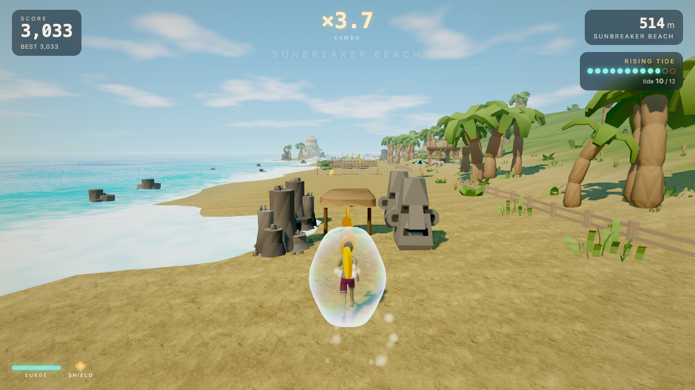
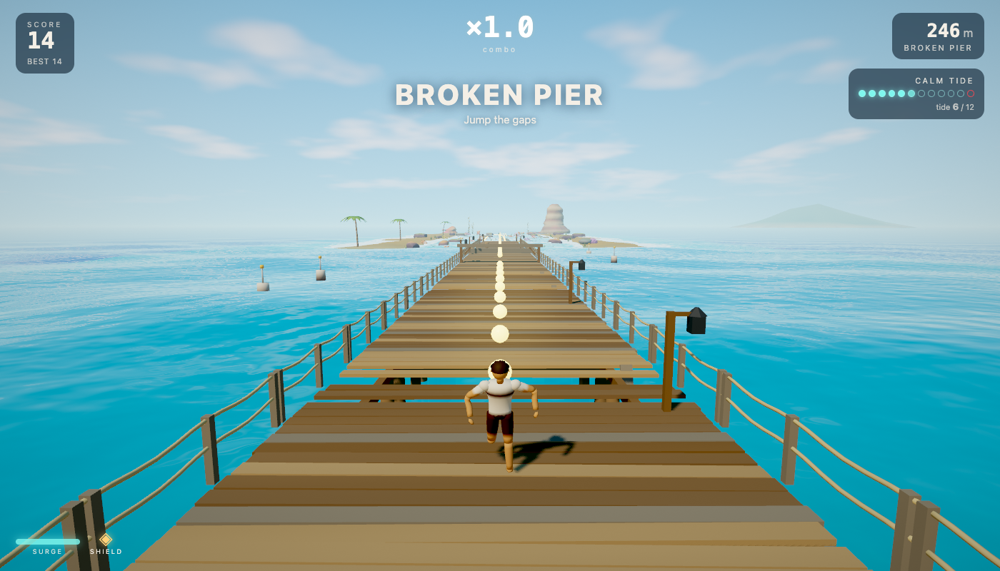
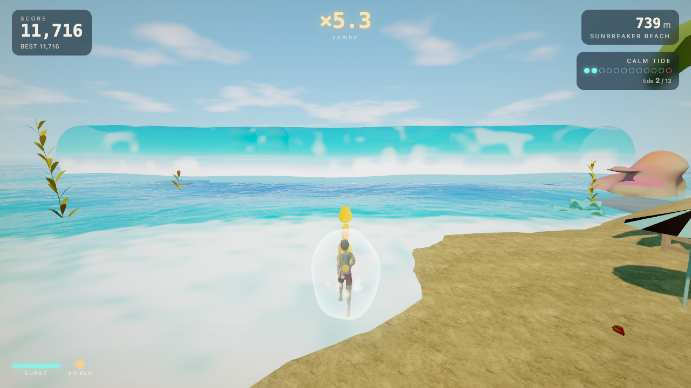
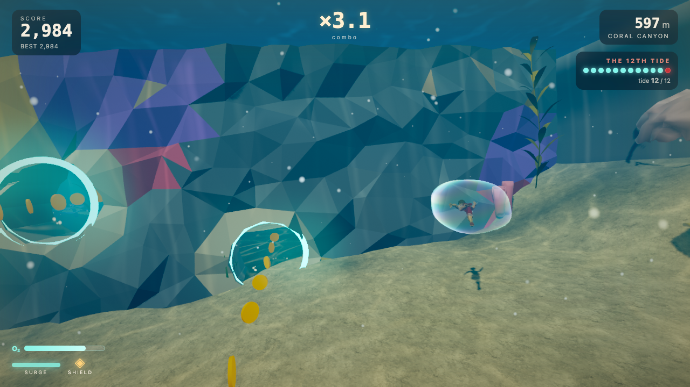
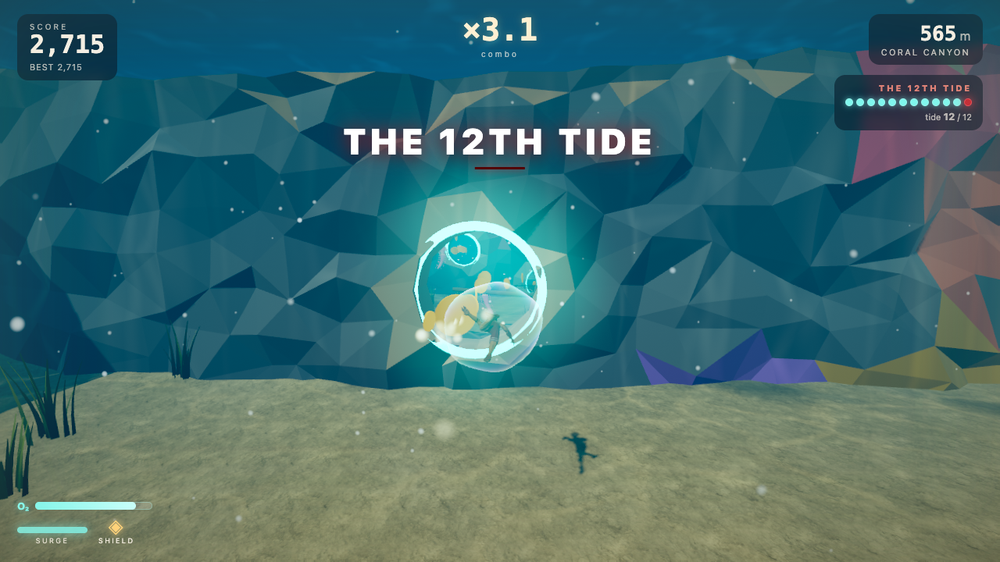
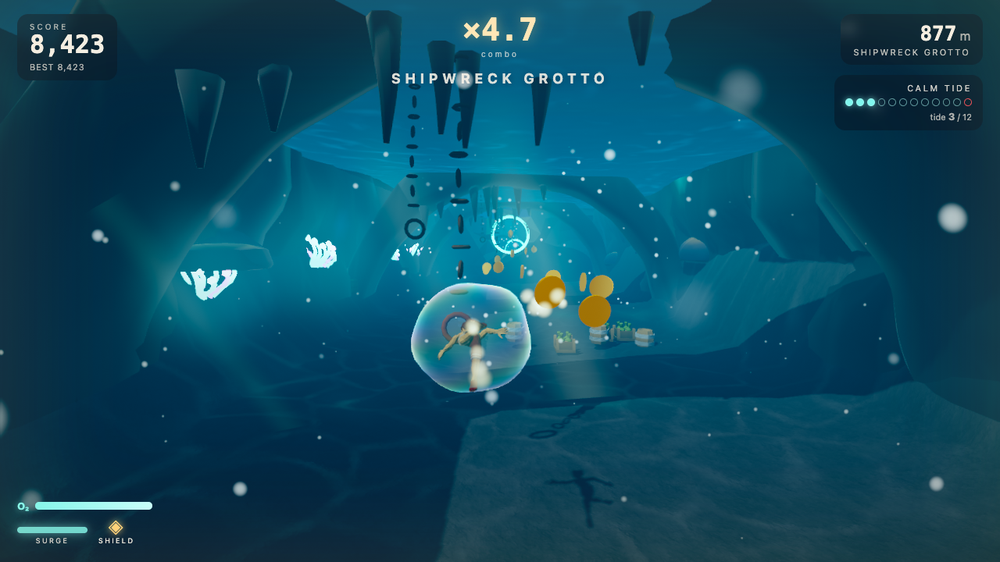

# The 12th Tide

A coastal endless runner for the browser. You sprint along a tropical beach, race a broken pier, surf a breaking wave at Shorebreak Point, dive into the sea (or off the end of the pier) into a coral canyon, thread its reef gates and a shipwreck grotto, steering with **your whole body in front of the webcam**: lean, hop and duck (or one hand, or the keyboard). The course is assembled from authored, seeded chunks, so every run is different. A tide counter climbs with every section; on the **12th tide** the ocean surges over the coast and you have to ride it out.

Three.js + TypeScript. Environments are built in Blender (through the Blender MCP) and exported as modular GLBs. All sound is synthesised at runtime.

| Beach | Pier | Diving in |
|---|---|---|
|  |  |  |

| Reef gates | The 12th Tide under water | Shipwreck Grotto |
|---|---|---|
|  |  |  |

## Run it

```bash
cd game
npm install
npm run dev        # http://127.0.0.1:5173
npm run build      # type-check + production bundle in game/dist
npm run preview    # serve the production build
```

Needs a WebGL2 browser. The camera needs `getUserMedia` (Chrome, Edge, Safari 17+, Firefox) and downloads MediaPipe's pose model (about 6 MB; the hand model is about 8 MB) from the CDN on first use; after that the game runs with no network.

### Demo course

For a demo, turn on **Demo course** on the title screen (or type `DEMO` as the course seed in Settings, or open `?seed=DEMO`). It is a set course that shows the whole game in about three minutes, gentler than a normal run so a presenter on the camera gets through it, then carries on at random:

1. **Sunbreaker Beach** (three sections): Reveille on the research station's steps, the HOWDY sign, sanderlings and pelicans, sandcastles and cannons in the lanes, a volleyball net to slide, crabs from 200 m.
2. **Broken Pier**: the gaps in the deck, then the gauntlet (cargo, beams over and under), then down a ramp onto a jet ski.
   **Bolivar Channel**: free steering across open water, buoys and logs, floating ramps for a flip, beached on a sandbar; then onto a board at the water's edge.
3. **Shorebreak Point**: air spots (go left from the left lane: a backflip off the lip through the coin arc, in slow motion), nets, flotsam, buoys, then the pier crossing (one pier while it's easy).
4. **Coral Canyon**: the wave collapses into a rip and you dive: the coral forest (turtles, garden eels, an octopus), reef gates with mines, the minefield, a jellyfish curtain, the fishing nets, the current canyon.
5. **Shipwreck Grotto**: through the cave mouth to the wreck and its glowing plankton, the curtains of chains with a current drifting you into them, the wreck's mines, then the Kraken's chamber (the boss), and back out.
6. **The rising tide**: the shark waters, then up onto the beach (Reveille races back to you), gulls diving at your lane, the wind and sea getting up, rain.
7. **The 12th Tide**: the surge floods the beach in a storm (lightning, sandcastles slumping); survive it and the sun breaks out with a rainbow.

## Controls

| | Camera: body (default) | Camera: head | Camera: hand | Keyboard |
|---|---|---|---|---|
| Switch lanes (on foot) | lean or step left / right | slip your head left / right: one lane per slip | hold your hand left / centre / right | tap A / D or ← / → |
| Steer (under water) | lean | move your head | move your hand | hold A / D |
| Jump (on land) | hop (or bob up in a chair) | bob your head up | raise your hand | Space, W or ↑ |
| Slide (on land) | duck | duck (or nod down) | drop your hand | S or ↓ |
| Swim up / down (under water) | rise up / crouch down | head up / down | hand up / down | W / S or ↑ / ↓ |
| Surge (short speed burst, cooldown) | both hands up | both hands up | close your fist | Shift |
| On the board (Shorebreak Point) | the same as on foot: lanes, hop = ollie, duck = tuck | the same; slip left from the left lane to go up the wave | the same | A / D lanes, Space ollie, S tuck |
| On the jet ski (Bolivar Channel) | you ride where you are: lean or step across the channel; hop and duck as on foot | slip to nudge across; bob / duck | your hand is where you ride | hold A / D to steer, Space hop, S duck |
| Pause / resume | | | Esc |
| Restart | | | R (also Enter on the results screen) |
| Mute | | | M |

**Camera runs get a little more room:** with any camera control (body, head or hand) obstacles, rows, gates and swim hazards are spaced 30 % further apart than on the keyboard, since a lean, slip or flick takes longer than a key press. (So the same seed lays out slightly differently with the camera than with the keyboard.)

**Body control** (MediaPipe Pose) is the default: stand back (or sit) with your head and shoulders in the picture and stand still for a moment to calibrate. Everything is measured in shoulder widths, so it feels the same near or far. Lean or step sideways for a lane, hop to jump, duck to slide, put both hands up for a surge; under water your body is where you swim. Raising your arms lifts your shoulders, so jumps and slides are held off while a hand is up. Switch to hand control on the camera setup screen or in Settings. Why the body rather than the head: a hop and a duck map one-to-one onto jump and slide, the torso is a big stable target for the tracker, and it still works seated; nods are small, tiring, and blur into the head turns people make to look at the screen.

**Head control** (the same pose model, shadowboxing): sit or stand facing the camera and hold still to calibrate; distances are in head widths. A quick slip (or turn) of the head left / right steps one lane that way, like a key tap: lanes are relative, so bringing your head back to the middle does nothing. A slip only counts if it starts near rest and ends well out to that side, and that side only re-arms once your head is back near rest, so the return (even a fast one that overshoots a little) never fires the other way. Bob up to jump, duck or nod down to slide, both hands up to surge. Under water your head is where you swim: on land the rest point quietly follows you as you settle in your seat, and when you go under, wherever your head rests then is the middle of the canyon; from there the swimmer simply follows your head (it is never re-centred while you're under).

The hand controller works with either hand, and everything is measured in palm lengths, so it feels the same near or far from the camera. Rest your elbow and hold your open hand at chin height to calibrate (it tells you to move to the middle of the picture, closer or back if needed). Left / centre / right picks the lane; a quick flick up jumps and a flick down slides (or a slow, bigger raise or drop). Bringing your hand back to rest never counts as the opposite move, a jump locks out slides for a moment (and the other way round), and nothing fires just after a lane change. A closed fist (held for a few frames) surges. Under water your hand is where you swim. If the hand is lost you keep your lane; after 1.5 s the run pauses and it resumes once the hand is tracked steadily again. The in-run strip under the runner shows your lane zone, flashes ▲ / ▼ when a jump or slide registers, and a dot shows the tracking speed. Sensitivity is in Settings.

The first run is an interactive tutorial (change lanes, jump, slide, back to the middle): the game slows to a near stop at each row until you make the move. Replay it from How to play.

## How it plays

- **Score** = distance × combo, plus near misses, pearls, risky lines and current rides.
- **Combo** (×1 … ×8) climbs with near misses, risky lines and ridden currents; it decays after six idle seconds and resets when you take a hit.
- **Shield**: you start with one. The second hit ends the run. Surviving a 12th Tide restores it.
- **Pearls** mark the intended lines; **pink pearls** mark the risky line (tighter, faster, worth more).
- **Currents** are drawn as drifting streaks: ride them for speed and points, or get pushed into the rocks.
- **Into the water**: run into the sea, or off the end of the pier, and you dive; a tidal surge carries you back up onto the beach.
- **Shorebreak Point** (surfing): from the beach you pick up a board at the water's edge (or run off a sloped pier onto it) and ride the wash at the foot of a breaking wave that towers on your left and peels along with you. It plays like the beach: three lanes, ollie (jump) and tuck (slide), the same controls. In the lanes float logs, barrels, crates and small reef rocks to ollie, sea stacks and buoys (3 m tall, no jumping them) to go round, nets strung between floats to tuck under, and patches of whitewater that slow you; rip currents shove you a lane over toward a rock. Anywhere the wave stands tall, go left once more from the left lane (step or move your hand far left) and you carve up the face and **launch off the lip**: about 3 m over the top of the wave and a second in the air, drifting back over the face, throwing a **backflip with a 360** on the way, slowed down through the top of the arc. In the air, tap A / D (or lean / hold a hand to a side) to add another 360, Space to grab; land square for the trick's points, half way round and you stumble; then you carve back down to the left lane. At **air spots** the wave swells taller and an arc of pink coins hangs over the lip along the path of the launch (up off the lip, over the top, back down); pink coins in the left lane lead up to them, and going up near where they end times the climb so you leave the lip right where the arc starts. Right on the way up bails out; there's no going up just before a pier. Sections in random order: **Open Break**, **Reef Slalom**, **Pier Break** (under piers whose legs stand in the middle lane, nets hanging over the outer ones), **Rip Channel**. You leave by diving as the wave collapses into a rip (into Coral Canyon) or by riding the wash onto a sandbar and running up the beach. On the 12th Tide the wave stands a third taller and the wash is full of wreckage, two lanes of every row; the pink line pays double. The wave itself is scenery: far ahead a rounded swell, it stands up and throws a fat frothing lip as you reach it, and heaps into whitewater behind you; around it the board's foam wake, spray on hard lane changes, foam round rocks and pier legs, a gull skimming the face, dolphins, surfers far out, the lifeguard tower and flags, the **Aggie Surf Club** shack and rental huts with racks of boards. Reveille waits on the beach.
- **The 12th Tide under water** is a rip current through a run of reef gates with one kind of hazard between them (tumbling cargo or a rock pillar); the bonus coins go through the harder hole of a twin gate.
- **Under water** each area has one kind of obstacle and ends at a reef gate: a coral forest, a run of reef gates with a mine between each hole, side currents sweeping you toward coral towers, a jellyfish curtain, a minefield (rows of moored mines across the canyon, one way through each), fishing nets (hanging from the surface: go under; standing on the seabed: go over), and shark waters (sharks cross at your depth after a two-note warning: swim up or down). In the grotto: the wreck's hull ribs, curtains of chains from the roof, or the wreck's mines. Reef walls cross the whole canyon; the only way on is through a glowing hole, which pays a bonus that grows with each gate in a row, gives a slipstream boost, and refills your **air** (14 s on the O₂ meter). Run out of air and you lose your shield, or the run.
- **Bolivar Channel** (the jet ski): a rental dock off the beach, or a ramp down from the end of the pier, puts you on a jet ski in maroon-and-white Aggie livery, about half as fast again as on foot, on open water with **no lanes**: you steer anywhere across a 14 m channel (A / D held; with a camera you ride where your hand or body is). Weave the mooring buoys and channel markers, hop the floating logs, duck the fishing lines strung between moored boats; a passing boat's wake tosses you into a little air, and the floating ramps throw a big one with a backflip and coins through the arc. You get off by beaching it on a sandbar (back up the beach) or ditching it over the reef (a dive). The 12th Tide here is a storm of wakes. Its own validator slices the channel along each section and keeps the stretches you can reach by steering, so every run of it has a way through.
- **Play as Reveille** (title screen): the collie is the player, on her own. It's the land course, beach, pier and Shorebreak Point, with no diving (collies don't): the course generator keeps to the land and the 12th Tide at the surf runs you up onto the sand instead of out to sea. She stands 1.2 m tall and 0.55 m flat, so a few things the runner slides under she runs under; everything else is the same course and the same rules. She barks on a surge. The demo course has a land version for her.
- **The Kraken**: at the back of the Shipwreck Grotto the cave opens into a chamber where a giant octopus hangs in the dark, two glowing eyes drifting back ahead of you. Its tentacles attack, each telegraphed by a red ghost of where it will land (and the arm coiling out of the wall, suckers pulsing): a **slam** down one side of the cave, a **sweep** straight across low or high, a **pincer** from both corners that leaves only the middle, a **grab** that shoots from its head to where you are and closes there. Each leaves a safe region at least a third of the chamber across, and the warning lasts longer than a swim from the far side (longer with a camera). Get to the end and it rears up into the roof: ESCAPED THE KRAKEN, +500. It is the last thing in the grotto most visits, and it's in the demo course.
- **The Shipwreck Grotto** is lower than the canyon: the seabed slopes down about 8 m to a cave mouth in a rock wall, and inside a stalactite roof caps the swim space in the dark. An up-current carries you back out.
- **Cannons and treasure**: cannons fire one slow cannonball down their lane when you're ~70 m away (a boom and smoke): jump it, or step aside. It only fires where the ball meets you clear of everything else in that lane. Jump a treasure chest and its lid flies open in a shower of sparkle for a bonus.
- **Critters**: from 200 m, crabs scuttle sideways across the beach (jump them); from 550 m, gulls dive at your lane. Their shadow grows on the sand first, so change lanes or slide. They only appear where the dodge is always possible.
- **Reveille** waits on the research station's steps at the start (her head follows you), then leaps up as you run past and gallops at your shoulder in her maroon blanket with the ATM monogram and her name, collar and gold tag. She runs on your footprints, so she jumps what you jump; she waits at the water's edge while you swim or surf and races up from behind when you're back on land.
- **Aggie touches**: a seaside research station with a maroon roof at the start, a HOWDY! sign you run past, maroon-and-white ocean research buoys round the pier and offshore, and the runner (shirtless, straw sun hat with a maroon band, maroon trunks, a dive pack with a white 12). Maroon-and-white volleyballs lie by the volleyball nets, on the sand and on the odd court up the beach.
- **Sound**: all synthesised. Waves build, break and wash back at their own pace, the wind gusts, gulls call from all around (single cries, the laughing call, pairs answering in the distance), a bell buoy clangs offshore; every coin gives the same short blip; Reveille barks when she joins you.
- **Wildlife** (nothing to dodge, just life): gulls standing on the sand and along the pier rails flap away as you run up, more wheel overhead, dolphin pods leap beside the beach for a few jumps, and sailboats drift on the horizon. Under water, fish schools part around you, mantas glide past, sea turtles paddle by, and in the dark grotto glowing plankton swirls in your wake.
- **Small touches**: footprints in the sand behind you (and Reveille's paw prints) that fade as they dry; sanderlings chase the backwash at the water's edge and lift off together as you come close; sandcastles beside the lanes slump when the 12th Tide floods them (and some stand in the lanes on the beach: jump them, or flatten one in a burst of sand); pelicans glide in a line over the water (one folds up and plunges in after a fish); under water, garden eels drop into the sand as you swim near and ease back out behind you, an octopus inks and jets away, and skimming the seabed kicks up sand. The runner stretches on take-off and squashes on landing, his hat lifts off on a close shave or a launch, he glances at what he just skimmed, shakes the water out of his hair as he surfaces and glistens until he dries. Reveille barks at diving gulls. A hit freezes for a beat and shatters the shield; the top of a launch off the lip goes into slow motion with a faint rainbow in the spray. Coins fly up into the score, each combo tier arrives with a shake, and a wave washes across the screen into a run and into the results.
- **Weather follows the tide counter**: the wind freshens (palms lean, dune grass bends, flags snap), the sea gets up with whitecaps, rain and lightning come with the 12th, and when you survive it the sun breaks out with a rainbow over the coast.
- **It gets harder quickly**: speed climbs from 12.5 to 23 m/s over the first 2 km, and the difficulty tier steps up at 200, 550, 1,000 and 1,600 m. Each step adds more walled-off lanes, denser rows mixing jumps and slides, reef gates closer together, and jellyfish beside the holes.
- **The tide**: calm for sections 1–8, rising for 9–11 (the sea creeps up the beach, currents strengthen, the sky darkens), and on 12 the surge arrives: the coast floods and the pink line pays double. Under water the surge is a rip current full of debris.

URL parameters for testing: `?seed=ABC123` (fixed course), `?quality=Low|Medium|High`, `?tutorial=0` (skip the first-run tutorial), `?autostart=1`, `?debug=1` (frame stats, backtick toggles), `?clean=1` (no UI), `?mute=1`, `?pose=run|swim|jump|slide` (character inspector).

## Repository layout

```
game/                 the web game (Vite + TypeScript + Three.js)
  src/main.ts           game shell: renderer, state machine, event wiring
  src/game/             runner, chunks, generator, validator, patterns/, tide, scoring, hand, camera, character, critters, wildlife
  src/world/            sky, water, materials, pools, ground, atmosphere, fauna, kit catalogue
  src/fx/               post pipeline, god rays, marine snow, current streaks, shield bubble
  src/systems/          audio (all synthesised), adaptive quality, fish
  src/ui/               menus, HUD, styles
  public/models/        reef kit (ours)      public/cove/models/   cove kit (ours + restyled CC0)
  public/runner/        runner kit + manifest.json (ours + 9 credited library imports)
blender/              Blender sources and build scripts (runner_kit.blend, runner/*.py, older kits)
tools/                headless test harness: gentest, runshot, keytest, handtest, poseshot, evalshot, glbinfo
docs/                 ARCHITECTURE.md, TEST_REPORT.md, screenshots, older design notes
archive/              the previous Tide Run prototype (not compiled)
ASSET_CREDITS.md      every third-party asset and library, with licences
```

## Tests

```bash
node tools/gentest.mjs 1000 40      # 1,000 seeded courses: route reachability, grammar, seams, 12th Tide schedule
node tools/runshot.mjs 60 SEED      # a bot plays for 60 s in GPU Chrome; screenshots + console errors + frame stats
node tools/keytest.mjs              # real key events: steer, jump, slide, surge, pause, restart
START=170 node tools/runshot.mjs 60 TIDE3  # the bot from 170 m: straight into Shorebreak Point
node tools/bodytest.mjs             # MediaPipe Pose pipeline with a fake camera + synthetic-pose tests (lean, hop, duck, hands up, swim, loss)
node tools/handtest.mjs             # MediaPipe Hands pipeline with a fake camera + synthetic-landmark gesture tests
node tools/handcamtest.mjs hand.y4m # a real hand (video from a photo) through Chrome's fake camera: lanes, jump, slide
node tools/hitboxaudit.mjs          # every hitbox must sit inside the model drawn there
```

See [docs/TEST_REPORT.md](docs/TEST_REPORT.md) for the results and what remains unverified (a real hand on a real webcam, for one).

## Credits

Design, code, shaders, Blender kits and audio are original to this project. Third-party items: Three.js (MIT), lil-gui (MIT), MediaPipe Tasks Vision (Apache-2.0, loaded at runtime), and the models listed in [ASSET_CREDITS.md](ASSET_CREDITS.md) (CC0 and CC-BY; the CC-BY authors are named in the in-game Settings → Credits panel).
